# 澄境 | Limina

**阅人际，留寸心。** *Glean the World, Guard the Heart.*

装在 DeepSeek Harness 桌面端里的**阅读与记录**插件。

它把「读」和「记」放在同一个界面里，并且读完能直接问模型：

- **读三种** —— 订阅（newsletter、播客、YouTube、博客）、电子书、论文；
- **记一处** —— 灵感速记、私密日记、读后感。

不需要注册账号，不需要第三方后端。**订阅、书、记录都存在你这台电脑上**；
只有你主动点的翻译、云端朗读、云端识别才会把内容发出去，界面每次都写明。

`MIT` · 4 个主视图 · 25 个 agent 工具

---

## 它长什么样

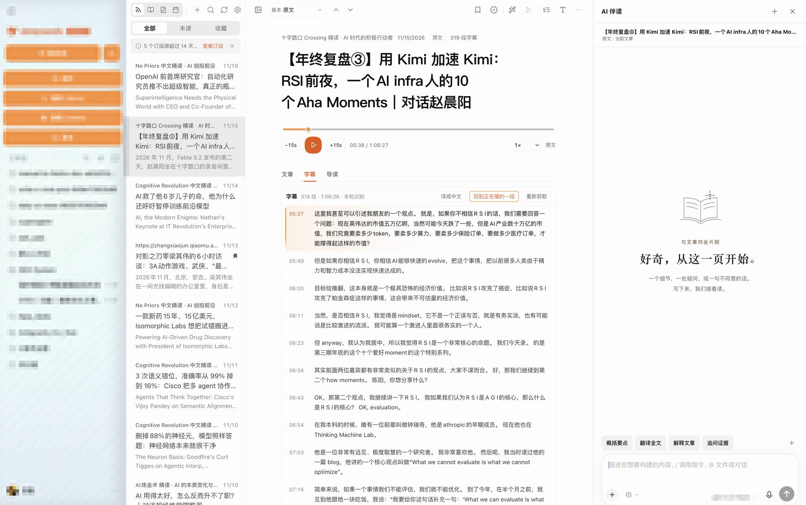

四个主视图，用**左侧栏最顶部那组图标**切换。左边三个是**读**（内容从外面进来），
最右边一个里装着**记**（内容由你写下）。

| | 主视图 | 读什么 / 写什么 |
| --- | --- | --- |
| 读 | **订阅** | RSS / Atom 源：newsletter、播客、YouTube 频道、独立博客 |
| 读 | **书** | 电子书：PDF 按原版式读，EPUB / MOBI / AZW3 / AZW / TXT 重排读 |
| 读 | **论文** | 按 arXiv 编号 / alphaXiv 链接 / DOI / 标题导入，先看速读卡再决定读不读 |
| 记 | **记录** | 里面分三块：**灵感速记**、**私密日记**、**读后感** |

**「记」为什么是一块而不是三块**：这三个模块共用同一份存储、同一个页脚、同一条
「只在本机」的边界；写读后感就是从「读完」那一行进来的同一个页面，不是另一件工具。
在顶上再拆三个 tab，只会让人以为得先找到一个入口才能下笔。

**第四颗图标叫「记录」而不是「日记」**：它里面装的三块，其中一块就叫「日记」。主视图
也叫「日记」的话，同一屏上有两个「日记」—— 点进去看到三块并列、第二块又写着「日记」，
分不清是「进去」还是「就在这儿」。

> **RSS / feed 是什么**：一个网站提供的「更新列表」地址。订阅它就是让阅读器替你
> 盯着那个站，有新文章自动收进来。下面提到的 newsletter、播客、博客，本质都是这个。

---

## 装之前，先确认四件事

| 需要 | 说明 |
| --- | --- |
| **DeepSeek Harness 桌面端** | 在 **0.2.2-rc.1** 上开发与测试。更低版本没实测过，遇到怪问题先升级宿主 |
| **macOS** | 开发与测试都在 macOS。Windows / Linux **未实测**，已知差异见下 |
| **Node.js 18 或更高** | **只有从源码安装时才需要** —— 仓库不含构建产物，得自己构建一次 |
| 一个可用的模型 | 翻译、解读、「问 AI」都用 Harness 里**当前选中**的模型，插件不代付、不代理 |

**非 macOS 的两处已知差异**：扫描版 PDF 的**本机 OCR 用不了**（用的是 macOS Vision）；
系统钥匙串取不到时，私密日记的密钥会退回 `0600` 文件而不是钥匙串（代码里有兜底，会告诉你）。

不知道有没有 Node：终端执行 `node -v`，显示 `v18.x` 以上就行。

---

## 安装

### 方式一：从 npm 装（推荐，不需要 Node）

1. 侧栏点 **「插件」** → **「添加插件」**；
2. 「包名或地址」填 `dsh-npie-reader`；
3. 点 **安装**，再点 **启用**；
4. **完全退出 App（`Cmd+Q`）再打开**，回到面板按 `Cmd+Shift+R` 强刷。侧栏出现
   **「澄境 | Limina」** 即为装好。

> 之前用本地目录装过这个插件的，先「卸载」再装这一版。

### 方式二：从源码装（想改代码时用）

先构建一次：

```bash
git clone https://github.com/BannyLon/dsh-npie-reader.git
cd dsh-npie-reader
npm install     # 装 4 个构建依赖
npm run build   # 生成 lib/index.js 与 lib/client.js
```

没有 git 就打开仓库页 → **Code** → **Download ZIP** → 解压，在解压出的目录里跑那两条
`npm` 命令。

再装进 App：

1. 侧栏点 **「插件」** → **「添加插件」**，「包名或地址」填**那个目录的绝对路径**；
2. 点 **「立即启用」**；
3. **完全退出 App（`Cmd+Q`）再打开**，回到面板按 `Cmd+Shift+R` 强刷。侧栏出现
   **「澄境 | Limina」** 即为装好。

> `npm run build` 不能省。跳过会报找不到 `lib/index.js`，或启动即 `failed to import`。

细节（`link:` 前缀、对账机制、`failed to import` 逐条排查）见
[安装与启动细节](docs/development.md#安装与启动细节)。

---

## 第一次打开：四个视图各自的第一步

进入插件后，**左侧栏最顶部**有一组四个图标，从左到右是 **订阅 / 书 / 论文 / 记录**；
同一行往右依次是频道名、添加（`+`）、搜索、刷新，**最右端是设置齿轮**。

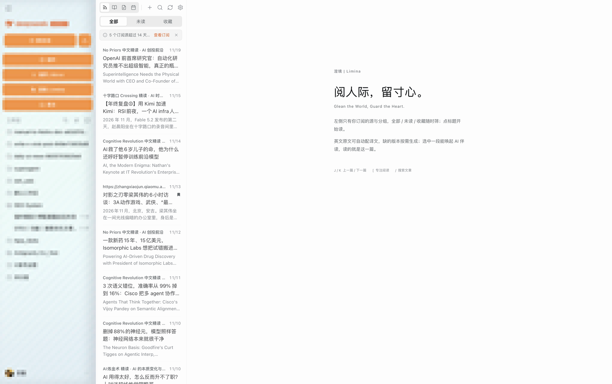

| 你想做的事 | 点哪里 | 第一件事 |
| --- | --- | --- |
| 订几个作者 | **订阅** | 点 `+` → **「粘贴订阅地址」**；想从内置目录挑就选 **「浏览推荐源」** |
| 读一本电子书 | **书** → 书架 | 先点 **设置（齿轮）→ 电子书书架**，加一个本机目录作为书源 |
| 读一篇论文 | **论文** | 粘 arXiv 编号（如 `2401.00001`）、alphaXiv 链接或 DOI，也可以直接上传 PDF |
| 记一条想法 | **记录** | 打开就是灵感速记，写完点 **「记下来」**（或按 `⌘↵`） |

**设置齿轮在「订阅」「书」「论文」这三个视图里都有**（工具栏右端）。记录视图的选项
就摆在它自己界面上，没有单独一页 —— 搜索/导出/清理都在它自己的工具条里。设置页分七类：阅读体验 / 电子书书架 / 字幕与识别 / 朗读 /
订阅管理 / 快捷提示词 / 关于。

**记得内容、记不清出处时按 `⌘K`**（Windows / Linux 是 `Ctrl+K`）：一块浮层面板
**一次搜四处** —— 订阅文章、书、论文、记录。结果按来源分组、每源最多 5 条，
`↑↓` 跨组走，回车直接跳回那一处；命中的文章与书还会告诉你「在记录里提到过几次」。
左侧那颗放大镜仍然是**在当前列表里筛**，两者不互相顶替。

---

## 读 · 订阅

把你信得过的作者集中到一处。**粘链接就行，不用自己翻页面找 feed。**

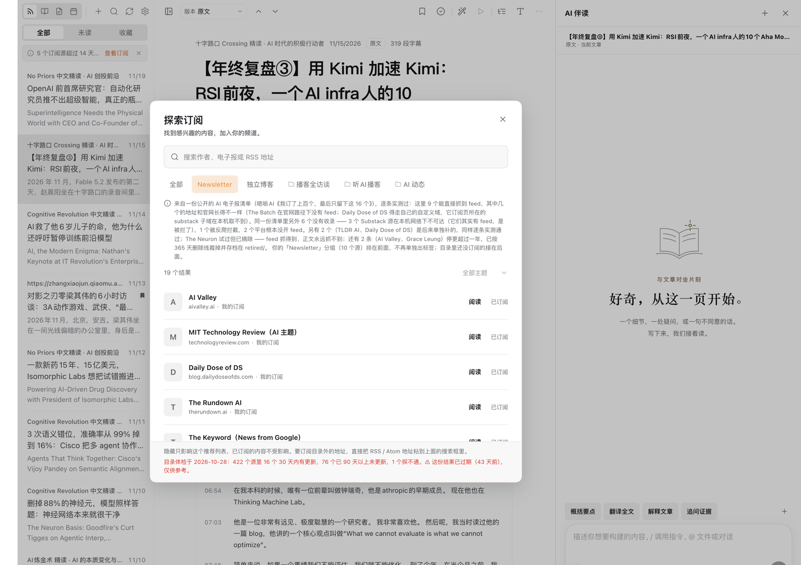

- **三种来源都吃**：RSS 2.0 / Atom / RDF。粘 **Apple Podcasts**、**小宇宙**、**YouTube**
  的节目或频道链接，会自动反查出订阅源（Apple 走 iTunes 目录最稳；小宇宙不公开 RSS，
  只能经 Apple 中国区目录反查；YouTube 只能拿到频道级 feed）。
- **内置目录带体检**：点「+」→「浏览推荐源」，里面有 Newsletter 18 家 + 独立博客 404 家，
  每行标「最新一篇 N 天前 / 已 N 天未更新 / 上次体检没抓到」，页脚写体检日期。
- **分组与历史**：自己的源按分组排在最前，目录里没订阅的接在后面；某个源可以
  **「补全历史文章」**，把更早的条目往回追进来。
- **正文语言四档**：原文 / 译文 / 对照 / 改写，在下拉里选（「对照」要等译文生成后才出现）。
- **播客能听，也能读**：单集边听边跟字幕，字幕本身还有「原文 / 双语 / 中文」一键轮转；
  字幕翻译**先走 Google 免费端点，不通自动落到模型**，并告诉你这次用的是哪个。
- **没有字幕也不绝望**：中文播客实测普遍不带字幕，可在**本机**把音频转成字幕
  （音频不出本机、不需要任何 key；首次要下一两百 MB 模型）。
- 读的时候随时**带着这篇问 AI**，或让它生成导读。

细节见[订阅与信息源](docs/features.md#订阅与信息源)、[播客、字幕与语音](docs/features.md#播客字幕与语音)。

## 读 · 书

本地目录、你自己的网盘里的书，配好书源就能读。

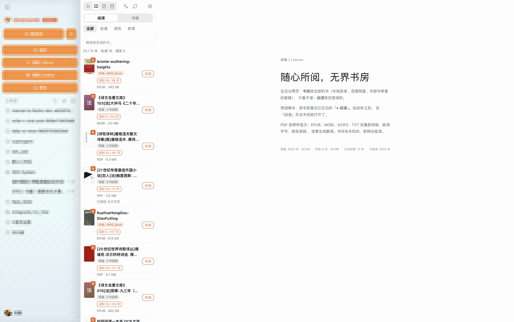

点任意一本进阅读页 —— 左边书架、中间正文、右边伴读：

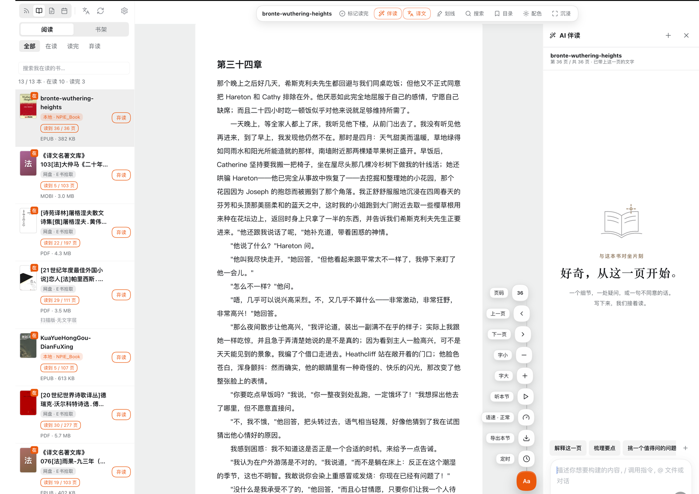

- **PDF 按原版式**：内置 pdf.js，页面原样渲染 —— 页内链接能点（外链开浏览器、
  内部目的地跳到对应页），划词翻译落在书页底部的独立浮层。版面固定，**字号改不了**，
  只能调配色（原色 / 护眼 / 薄荷 / 夜间四档）与亮度。
- **重排格式**：EPUB / MOBI / AZW3 / AZW / TXT 走重排 —— 字号、行高、版心可调，
  **六种纸色**（白色 / 纸张 / 护眼 / 雾蓝 / 深色 / 纯黑），书自带目录可用，
  支持全书搜索与划线笔记。重排不还原原书图片与版式，要原版式请先转 PDF。
- **读得下去**：抽正文 → 切章 → **逐章中文解读**；整本可导出成 agent 按需加载的
  skill 包，让模型一次只读一章。
- **听得下去**：朗读用本机或你自配的云端语音，可定时关闭，可导出 MP3。
- **读完就写**：在阅读器顶部点 **「标记读完」**，回到 **书 → 阅读** 并切到 **「读完」**
  这一筛，那一行会出现 **「写读后感」**，点进去直接落到日记的读后感模块，
  并带着这本书的划线侧栏。

书源在 **设置（齿轮）→ 电子书书架** 里配：加一个本机目录、授权一个网盘、生成书单，
三步走完书架就有书了。

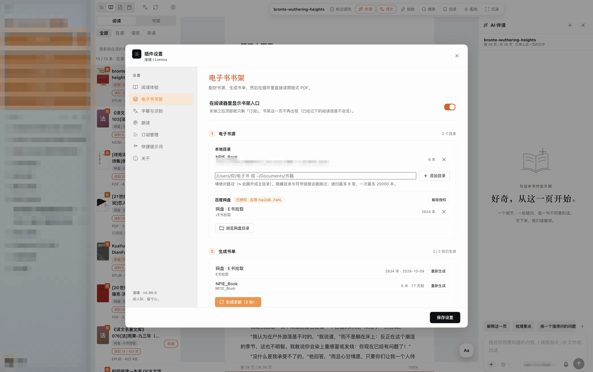

细节见[电子书](docs/features.md#电子书)。

## 读 · 论文

论文和书的差别是**结构可预期**：先看标题、作者、venue、摘要，再决定读不读。

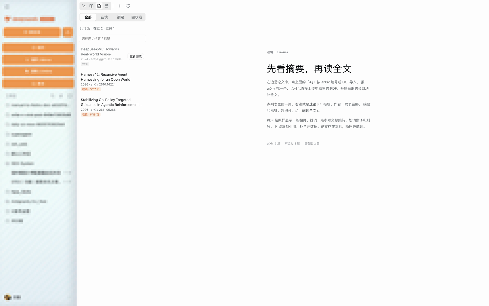

点开一篇就是原版式 PDF，右侧挂着伴读：

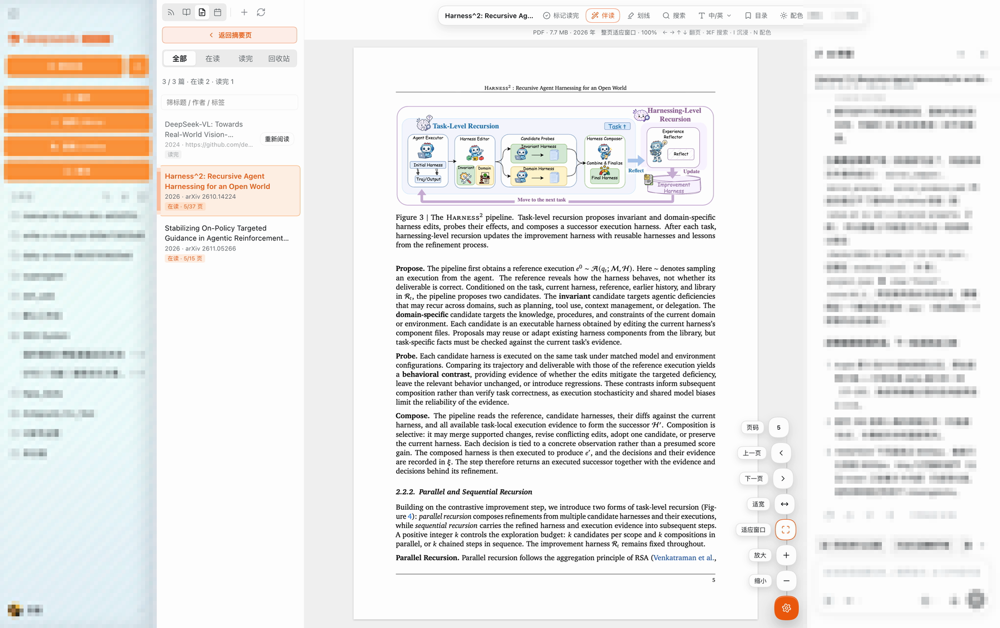

- **三种导入方式**：arXiv 编号 / DOI / 标题，或直接上传本地 PDF；**alphaXiv 页面
  链接**也认（0.90.0）—— 只在 alphaXiv 上发、没有 arXiv 编号的论文靠它才导得进来。
  开放获取的会自动补下全文（元数据来自 **arXiv → alphaXiv → Crossref → OpenAlex**），
  付费墙内的给你 DOI 落地页并提示手动上传。
- **搜索只给对得上的**：整段按标题短语查，再退回逐词 AND；只沾了其中一两个词的
  论文会被筛掉，不再拿一屏无关结果充数。
- **速读卡**：标题 / 作者 / venue / 摘要 / 标签 / 进度，先做决定再打开正文。
- **页级翻译**：翻译本页或翻译全本，公式、图、表格、版面保留，译文按页落盘缓存，
  重新打开插件也不用重译。
- **写论文用得上的两件**：复制 BibTeX 引用；补全元数据（只填空着的字段，已有的
  标题摘要绝不覆盖）。
- **落盘之后就是一本普通 PDF**：目录、找词、划词、划线、逐章解读、读后感全部原样
  复用书架那条链路。

细节见[论文](docs/features.md#论文)。

## 记 · 灵感 / 日记 / 读后感

三块，一个页面，都只在本机。

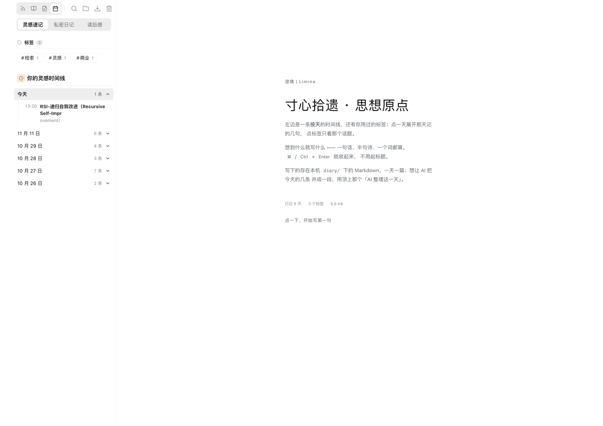

**灵感速记** —— 打开即写；在订阅、书、论文里按 `L` 随时唤起浮层（记录视图不响应，
那儿本来就有输入框）。标签云 + 时间轴，也能把一条灵感挂到某本书上，
形成「书 → 想法」的流转。

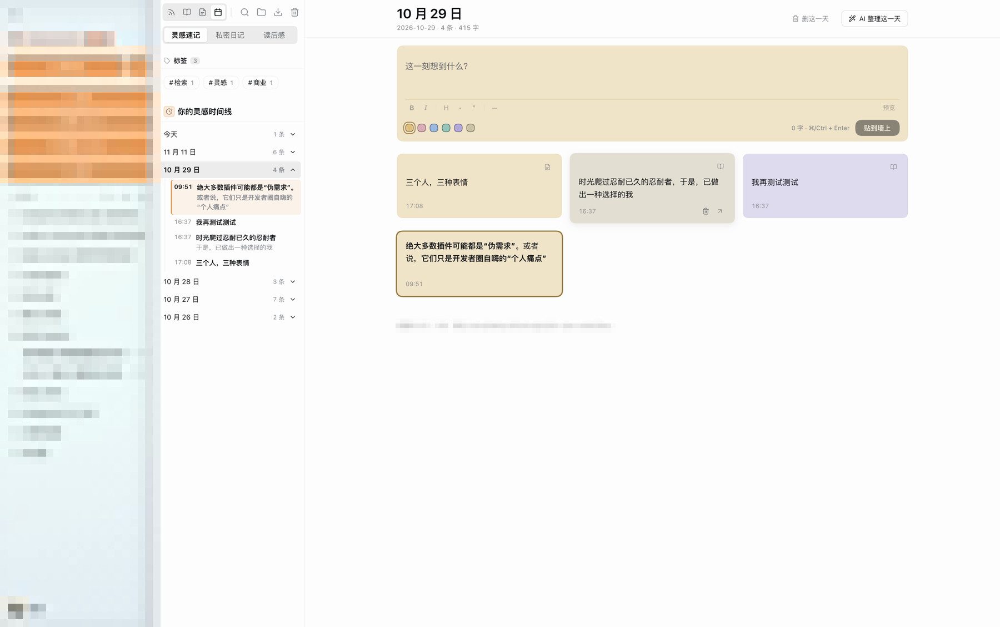

**私密日记** —— 一天一篇，AES-256-GCM 独立加密，密钥在系统钥匙串；钥匙串不可用时
退回 0600 文件并**如实告诉你**。带情绪与日历，日历只统计私密条目。

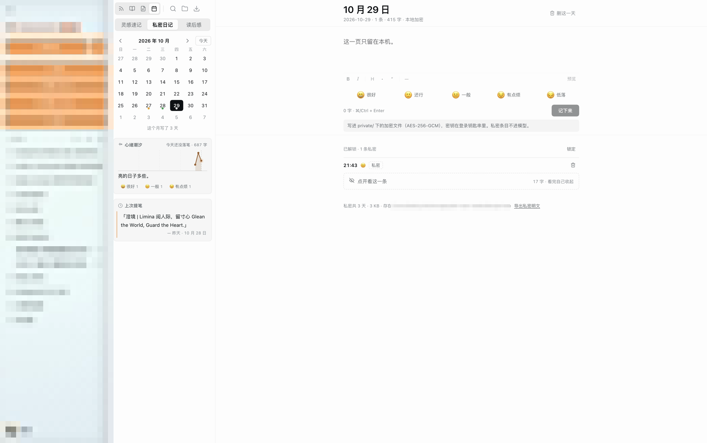

**读后感** —— **只对标记为「读完」的书开放**，结构化模板，旁边挂这本书的划线。
也可以从记录视图直接进来，手动选书。写之前可以点一次「**生成提纲**」：拿这本书的
逐章解读摘要、你的划线和你已经写下的草稿，换回一份**只属于这本书**的提纲 ——
再点一次就是**换一份**（不是又贴一份上来）；正文里已经有你写的字时，它不会擅自
替换或追加，而是先把提纲摆出来问你「换成这份，还是接在末尾」。

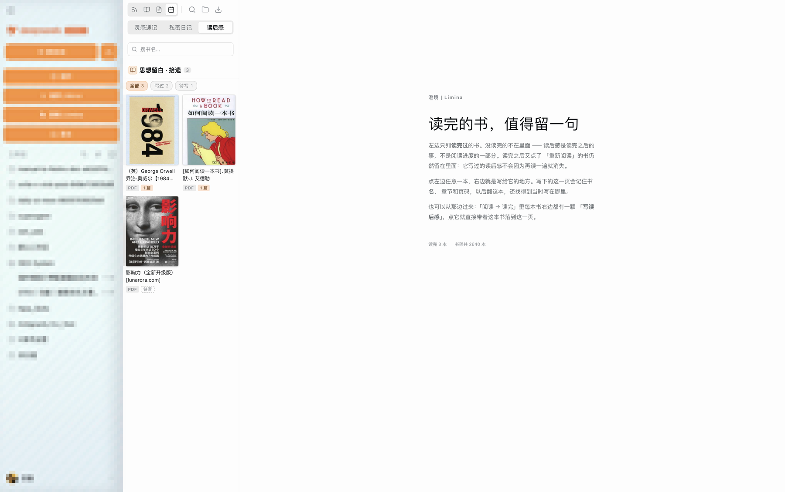

三块共用一套存储与页脚，但**互不串档** —— 切模块会连错误提示一起清掉，上一块的报错不会跟过来。
顶部只留**搜索 · 文件夹 · 导出**三颗：私密日记没有导出（它有自己的「导出私密明文」，解锁后才出现、
要点两次），「清理没在用的图」挪到日期栏、与「删这一天」同一行。

**周报** —— 接口已就绪（`GET /weekly?week=&weeks=`，ISO 周、一次汇总最近 8 周），界面还在设计：
记录是三个独立模块，周报该按模块各出一份还是合成一份没定，等形态定了再挂出来。

细节见[日记与灵感](docs/features.md#日记与灵感)。

---

## 给 agent 用

25 个工具，按前缀分四组：`rss_*`（9）· `book_*`（6）· `diary_*`（5）· `paper_*`（5）。
在 Harness 对话里说「把我订阅的 newsletter 这三天讲了什么汇总一下」，走的就是这些。

护栏有三条，值得先说：**私密日记对模型不可见**（`scope` 固定 public，读不到也改不到）；
**改与删必须先 `diary_today` 拿到编号**，模型不能自己数；**没有 `paper_delete`** ——
删论文连 PDF 一起删，这条路留给你自己点。

语义、时间窗、检索闸门与内置目录取舍见[Agent 能力](docs/agent-tools.md)。

## 你的数据在哪

| 内容 | 位置 |
| --- | --- |
| 设置、订阅、书单索引、阅读进度 | `~/.dsh/storages/dsh-npie-reader/` |
| 灵感 / 读后感（明文）与私密日记（加密） | 同一目录下的 `daily/` 与 `private/` |
| 音频缓存、页译文缓存、本机识别模型 | 同一目录；删掉只会重新生成，不动你的内容 |

- **备份**：拷走整个 `dsh-npie-reader` 目录。私密日记要能解开，还得有**同一台机器**
  钥匙串里的那把钥匙（换机器后旧条目只能看到密文）。
- **卸载**：先在插件面板停用、再删插件目录；**数据目录不会自动删**，要清干净得自己删。
- 你填过的云端语音 / 识别 API key 存在同目录的设置文件里（文件权限 `0600`，
  仅当前用户可读），**不在**系统钥匙串里。

## 常见问题

**装完侧栏没有入口？** 确认走完了重启那步（`Cmd+Q` 完全退出后重开）。还没有就查日志里有
没有 `service started`：源码装的跑一遍 `npm run build` 再重启；npm 装的先卸载同名旧版再装。

**订阅加了却不显示文章？** 有些站点的 feed 只给最近 10 篇摘要，正文要单独抓；
还有的要求登录。「补全历史」能往回追，但追不到站上没公开的内容。

**电子书列表是空的？** 还没配书源。设置 → 电子书书架 → 加一个本机目录。
网盘（百度）需要先注册开放平台应用，属于可选步骤。

**翻译一直转圈？** 翻译用的是 Harness 当前选中的模型：确认 Harness 里配了可用模型，
且它能正常对话。Google 字幕翻译不通会自动落到模型，不影响使用。

**能读公众号吗？** 不能 —— 公众号没有官方 RSS。可以自己搭一个转 RSS 服务，
把它的 feed 地址订阅进来。

**日记会被模型看到吗？** 私密日记不会（对模型完全不可见）；灵感与读后感是明文，
模型能读到 —— 需要它帮你整理时，这正是前提。

---

## 开发

```bash
npm install
npm run build     # lib/ 不入库，发布前现建
npm test          # 单元测试
npm run verify    # 构建 + 单测 + 契约守卫
```

带真 Chrome 的视觉 / 布局检查需要本机浏览器，单独跑 `npm run verify:all`。
完整命令、守卫脚本与内部契约见 [开发](docs/development.md)。

## 已知边界

- **不抓公众号**：只能读你自己搭的转 RSS 服务。
- **Win / Linux 未实测**：本机 OCR 只在 macOS 可用（依赖 macOS Vision）；钥匙串取不到时
  私密日记退回 `0600` 文件。
- **重排不还原图片与原版式**（EPUB / MOBI / AZW3），要原版式请先转 PDF。
- **PDF 不能改字号**（版面固定），只能调配色与亮度。
- **论文没有朗读**，朗读只在播客与重排电子书上。
- **云端语音识别会上传音频**，界面上明说；本机识别则不出本机。
- **翻译与解读只用 Harness 当前选中的模型**，插件不代付、不代理。

做不到的、故意不做的、已知没解决的，全部列在 [边界与已知限制](docs/limits.md)。

## 文档

| 文档 | 内容 |
| --- | --- |
| [功能详解](docs/features.md) | 48 项功能的完整说明，以及每一项「为什么这么做」 |
| [Agent 能力](docs/agent-tools.md) | 工具语义、时间窗、检索闸门、内置目录取舍 |
| [设计笔记](docs/design-notes.md) | 已修正的缺陷：现象 / 根因 / 修法 / 守卫用例 |
| [开发](docs/development.md) | 构建、测试、守卫脚本、契约、数据位置、安装细节 |
| [边界与限制](docs/limits.md) | 做不到的、故意不做的、已知没解决的 |
| [CHANGELOG](CHANGELOG.md) | 逐版本变更 |

## 安全

插件**不内置任何凭证**、没有作者的服务器；私密日记独立加密且对模型不可见；
本地路由自带回环校验（挡 DNS rebinding），外抓第三方地址有私网守卫。

安全设计与**明确的残余风险**见 [SECURITY.md](SECURITY.md)。发现漏洞请走
GitHub 的 **Security → Report a vulnerability**，不要开公开 issue。

## 许可

MIT（`Copyright (c) 2026 Banny`）。第三方组件的许可与版权行见
[THIRD-PARTY-NOTICES.md](THIRD-PARTY-NOTICES.md)：pdf.js（Apache-2.0）、
Milkdown（MIT）、agentero motif（MIT）、chinese-independent-blogs（MIT）、shuting（MIT）。
